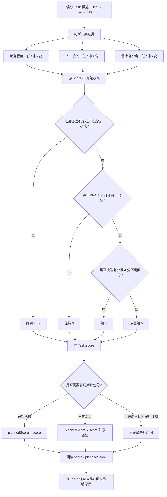

# Claro Task 估分指南

> 目的：给 Claro Task 的 `score` 做 1-5 分校准，避免把估分误当估时，也避免 4/5 分膨胀。

---

## 估分边界

- `score` 是任务复杂度分，范围固定为 `1-5`。
- `plannedScore` 是周期 / 计划内承接分。一个 Task 可以只把一部分工作量排进当前周期，所以 `plannedScore <= score` 是正常情况。
- `estimate_hours` 是估时，不是估分。除非用户明确要求估时，否则不要更新 `estimate_hours`。
- 估分必须有原因，原因至少覆盖：反复程度、人工接入、需求复杂度。

---

## 总分与计划分

| 字段 | 含义 | 存放位置 | 何时更新 |
| --- | --- | --- | --- |
| `score` | Task 本身的完整估分，也就是做完整个 Task 的工作量。 | Task 基础字段 | 创建 / 收尾 / 重估 Task 时更新 |
| `plannedScore` | Task 在某个周期 / 计划里被安排进去的分数，也就是本轮计划承接多少工作量。 | Task 与周期的排期关系 | Task 排进周期、调整周期承接范围时更新 |

默认规则：

- 完整工作量排进当前周期：`plannedScore = score`。
- 只排入一部分工作：`plannedScore < score`，原因要写入周期排期备注。
- 存量未分配 Task 进入未设置周期时，系统会用 `score - 已计划分` 计算剩余计划分，且不小于 `0`。
- 补历史已完成 Task 且没有“只排部分”的证据时，按完整承接处理：`plannedScore = score`。

当前 Claro CLI 暂未暴露 `plannedScore` 命令。页面使用的接口是：

```text
GET   /api/squads/<squadId>/task-cycle-board
GET   /api/squads/<squadId>/task-cycle-schedules?taskId=<taskId>&cycleId=<cycleId>
PATCH /api/squads/<squadId>/task-cycle-schedules
```

`PATCH` body：

```json
{
  "taskId": "1552",
  "storyId": "1118",
  "epicId": "4900415",
  "cycleId": "32",
  "ownerId": "45",
  "plannedScore": 3,
  "note": "计划分说明"
}
```

---

## 默认口径

估分先从 `3` 开始，再根据证据上下调：

| score | 使用条件 |
| --- | --- |
| 1 | 占位、登记、迁移壳、小文档或极小配置；基本没有验证和协同。 |
| 2 | 单点小改或小流程补充；验证明确，最多一个系统，基本无返工。 |
| 3 | 常规交付默认值；涉及正常开发 / 排查 / SQL / ETL 小改 / 回归，但范围可控。 |
| 4 | 谨慎使用；需要同时满足至少两个强证据：跨系统或跨仓库、多轮验证/返工、人工或平台协同、生产发布/回滚风险。 |
| 5 | 极少使用；必须同时满足高复杂度、明显反复或阻断、强人工接入、生产链路高风险，且 4 分不足以区分工作量。 |

批量估分时，如果 4/5 分超过整体任务数的 25%，必须二次复核。常见情况应落在 2/3 分。

---

## 三类证据

### 反复程度

- 低：一次完成，验收口径清晰，无明显返工。
- 中：有多轮验证、补文档、轻微口径调整。
- 高：反复排查、验收口径变化、修复后再次验证、阻断重查。

### 人工接入

- 低：Agent 可独立完成，用户只做最终确认。
- 中：需要用户确认口径、协助判断归属或平台状态。
- 高：需要平台权限、发布审批、数据修复、外部 owner 处理阻断。

### 需求复杂度

- 低：单文件、单命令、单文档、单 Task 元数据。
- 中：单系统内的代码 / SQL / Change 修改，有明确验证。
- 高：跨系统、跨仓库、多表链路、生产调度、导出链路、前后端 + DB 迁移。

---

## 校准规则

- 不因为“任务重要”直接给高分；只按反复、人工接入、复杂度三项证据打分。
- 不因为任务已完成就补高分；完成顺利的复杂任务通常是 `3`，不是 `4/5`。
- 平台阻断只有在实际影响交付收口时才上调；普通 CLI 或认证问题不自动上调。
- 描述或产物不足时，不靠标题猜高分；先补上下文，无法补时按保守分处理。
- 批量历史任务估分时，先看整体分布，再检查每个 4/5 是否有足够证据。
- 写了 `score` 后不要遗漏周期 `plannedScore`。如果 Task 已排入当前周期，或用户要求补计划分，必须回读周期排期并写入 `plannedScore`。

---

## 估分流程图



---

## 原因格式

给 Claro Task 写评论或最终回复时，用同一格式：

```text
估分：score=<1-5>
计划分：plannedScore=<本周期计划分或未设置原因>
依据：
- 反复程度：低/中/高，<一句证据>
- 人工接入：低/中/高，<一句证据>
- 需求复杂度：低/中/高，<一句证据>
结论：<为什么不是更高或更低>
```
