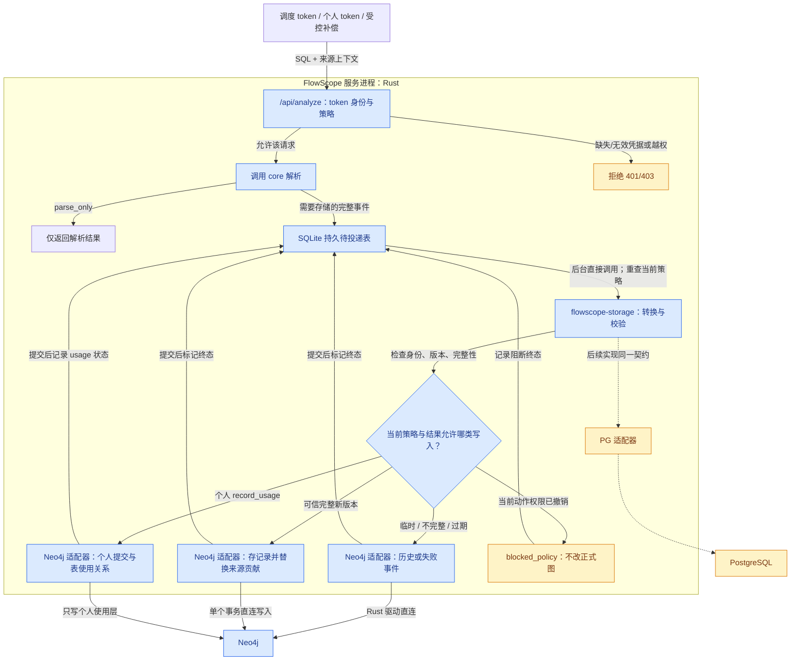

# 方案 B：FlowScope Rust 实时解析与独立存储层设计

状态：方案 B 规划稿；用户已确认“临时解析留记录，可信来源更新正式图”和“FlowScope 内使用 Rust 存储层，不依赖 Python 服务”。用户随后批准首批实现，当前成果见 [implementation-result.md](./implementation-result.md)。本文保留完整目标设计；已实现接口以 [API 使用文档](../../../docs/guides/lineage-storage.md) 为准。

## 1. 决策

1. FlowScope core 保持纯解析；在 CLI serve 的应用层取得完整解析结果后接入存储投递。
2. 在 FlowScope workspace 新增 `crates/flowscope-storage` Rust crate：包含标准存储模型、解析结果转换、版本规则与数据库适配。CLI serve 在同一进程调用它，通过 Rust Neo4j 驱动直连数据库；不引入 Python 运行依赖，不通过 HTTP 调用 neo4j-http-service 写入。
3. 首期只实现 Neo4j 适配器与统一存储契约；PostgreSQL 先给模型和接口，不要求双写。
4. 参考 neo4j-http-service 的图结构和 loader 规则，逐项移植成 Rust 并用固定样本对照。实时与日批补偿最终使用同一个 Rust 转换器和提交入口；日批快照由 Rust 导入，不要求改造或运行 Python loader。
5. 解析记录、来源版本、正式当前图分开保存。正式图是当前有效来源贡献的投影，历史解析不直接参与默认正式查询。
6. 可靠投递使用 FlowScope 服务侧独立、持久化的 SQLite 待投递表；不复用会截断 JSON、只记日志的 audit_log。首期按单实例加持久磁盘设计，容量与磁盘失败可观测。多实例或不同部署拓扑须重新评估事件存储位置，不能把本机 SQLite 当作跨节点队列。
7. 首期交付解析、记录、正式血缘更新及状态读取；已有 Python 检索和 embedding 只作为外部兼容对象，不能成为新链路的启动、元数据获取或验收依赖。
8. 统一 `/api/analyze` 根据已认证 token 绑定的服务端策略执行动作：调度默认 publish，个人默认 record_usage，均须管理员启用和范围校验。个人图标记与正式血缘分开；请求不能自行提升权限。生产严格模式要求 Bearer token，旧匿名请求只在明确迁移窗口保留 parse_only。

## 2. 目标链路

读图目标：能够看出 FlowScope 进程内的解析、持久化和 Rust 写入调用，确认它直接连接 Neo4j，以及临时记录和正式替换的区别。蓝色表示重点拟建模块，黄色表示后续 PG；均不表示已实现。

后台 Rust 任务直接调用存储 crate，调用方收到结果仅表示一次处理结果；数据库事务提交后才把本地事件标记为终态。数据库提交后连接中断、或进程在本地标记前退出，均用同一 event_id 重放并查询持久回执。不存在 FlowScope 到 Python 写入服务的 HTTP 跳转。

## 3. 仓库与模块职责

| 位置 | 建议职责 | 明确边界 |
|---|---|---|
| FlowScope `flowscope-core` | AnalyzeRequest → AnalyzeResult | 不包含 PG/Bolt/HTTP 存储客户端 |
| `flowscope-cli/src/server/api.rs`、`state.rs`、`mod.rs` | 统一 analyze 的身份/策略编排、配置与生命周期 | 处理 HTTP 请求；不直接写 Cypher |
| CLI 拟增 `server/lineage_policy.rs` 与管理 API 模块 | token/主体、SQLite 策略、运行时 revision、预览与启停 | 管理动作独立授权；不从请求自报身份推导权限 |
| app 拟增策略页面及现有 AuditPage | 管理调用方和规则、预览、保存生效、审计结果回溯 | 后端 API 同样校验管理权；页面隐藏不是权限控制 |
| CLI 拟增 `server/lineage.rs`、`server/lineage_outbox.rs` | 解析编排、持久事件、后台存储调用、状态查询 | 同进程调用 storage；SQLite 阻塞 I/O 走 spawn_blocking |
| `flowscope-storage/src/model.rs`、`store.rs` | LineageEvent / Snapshot / ApplyOutcome 与 LineageStore 契约 | 类型化输入；不依赖 Axum、CLI 参数或 CSV |
| `flowscope-storage/src/normalize.rs` | AnalyzeResult + 来源上下文 + 元数据 → LineageSnapshot | Rust 纯函数；区分物理/逻辑身份和六类边语义 |
| `flowscope-storage/src/service.rs`、`error.rs` | 质量预检、提交/撤回编排与结构化错误 | 版本竞争的最终判断由后端事务执行，不能只在此处预读判断 |
| `flowscope-storage/src/neo4j/` | 驱动、约束、事务、贡献物化、回执与当前版本读取 | Rust 驱动直连；封装 Cypher 和锁内版本判断 |
| CLI 拟增 `server/lineage_import.rs` | CSV/JSON 快照导入及批次完整性校验 | 随 serve 功能编译；逐来源生成相同事件，不通过 Python 程序转换或写库 |
| 后续 storage 中的 PG 适配器 | PostgreSQL 同等存储语义 | 首期不建立空实现；不改变标准转换器 |
| neo4j-http-service 原项目 | 图结构、loader 规则、固定基线和可选查询对照 | 只作为参考与外部兼容对象，不参与新写入调用链 |

从现有 load_table_meta/load_column_meta/load_reads_from/load_sync/load_joins/load_unions/load_cte/load_col_lineage/load_window_controls 逐项识别规则，以固定输入/预期样本验证 Rust 移植。不是直接复制 Python 文件，也不通过 FFI、嵌入解释器或子进程复用；现有 `_neo4j_writer` 的批次提交方式不作为新事务模型。

依赖方向为 `flowscope-cli → flowscope-storage → flowscope-core`；storage 仅使用 core 的公开结果类型，core 不反向依赖 storage。Neo4j 驱动只放在 storage 后端中。CLI 沿用现有 serve feature 引入可选 storage 依赖，普通解析及 WASM 不加载数据库驱动，不新增一组无实际用途的开关。

实施时在根 Cargo.toml 登记 workspace member/dependency，并更新 CLI 的可选依赖和锁文件。Neo4j Rust 驱动的版本在 P0 核查 Neo4j 5.27/Bolt、显式事务、异步生命周期、TLS、项目 Rust 工具链和 Linux glibc 2.17 打包约束后冻结；本规划不把未验证库版本列为已可用。连接池由服务启动时初始化并共享，退出时完成在途事务处理及资源释放，不按每条边建立连接。

规则移植需同时覆盖现有来源质量检查、SYNC 特殊来源推断、字段类型/别名/位置映射、过滤条件、UNION、窗口控制，以及共享/legacy 的保护规则。旧查询若继续作为客户端使用，需要单独做兼容评估；新链路通过 Rust 状态读取与 Neo4j 直查独立验收。

## 4. 标准事件和身份

事件必须包含以下语义；具体 JSON 字段命名在接口评审时冻结，不能把此表当成已存在 API。

| 字段组 | 内容及用途 |
|---|---|
| 投递身份 | event_id、request_id、contract_version；同一 event_id 内容不同报冲突，不静默覆盖 |
| 调用身份与策略 | principal_id/type、token_id、policy_revision、effective_action；由服务端创建，不接受自报提权 |
| 来源身份 | source_system、source_id、source_kind、environment；例如 change:123、mario:456；名称只展示 |
| 事件类型 | observe / record_usage / publish / execute / withdraw；个人解析提交、发布定义与执行记录分开 |
| 源版本 | source_version + 可比较的来源顺序；发布 ID/修订号优先，不能用请求到达时间或 SQL hash 充当顺序 |
| 解析上下文 | parser_build、dialect、解析选项、schema_snapshot_id、模板与动态绑定上下文 |
| 内容 | 完整原 SQL、完整 AnalyzeResult、raw_sql_md5、可选 sqlFingerprint/version |
| 补充元数据 | task/template/export 信息、目标与来源表、物理字段、owner/comment、元数据来源及快照版本 |
| 时间 | source_updated_at、observed_at、received_at；职责分别是源变更、观察和接收 |
| 写入结果 | parse_status、lineage_status、usage_status、effective_action、policy_revision、reason、current_revision、metadata_status；解析与两类图写入分别报告 |

上述字段按动作定义必需性：publish 需要正式来源 ID 和版本；record_usage 需要可信个人主体，事件 ID 由服务端生成，不要求个人伪造任务或发布版本。

稳定来源身份与解析产物身份是两回事。同 SQL 被两个任务复用，必须有两个来源归属；同任务改名不能变成新来源。

`source_version` 决定业务定义先后；同业务版本因 parser/schema 修正重解析，由受控的 analysis_revision 决定是否发布新的解析产物。解析器版本字符串本身不做字典序大小比较，也不能覆盖更新的源版本。

原 task_sql_md5 保留为原 SQL 内容标识；SQL 指纹只用于归组，既不能决定源新旧，也不能证明解析成功。同 SQL 在不同 schema 或参数下需要保留不同解析产物。

已有 HTTP sourceName 不足以做这个契约。旧 UDF 可以继续生成观测；要发布正式当前图，来源适配器必须补齐稳定 ID 和版本。来源可信度由已认证的接入配置决定，不能由任意客户端在请求里自称 production。

## 5. 统一 analyze、token、策略页面与写入时机

详细功能/API/数据规划见 `research/policy-page-and-personal-usage.md`。本节取代前稿的“旧 analyze 只能观察、另设发布入口”和“策略只在重启时加载”的设计。

### 已核实的 SQLite 与请求现状

现有 `/api/analyze` 支持 sql/files、解析选项、sourceName/source_name，没有调用主体或写图权限字段；当前 Rust 应用未验证 Authorization。Hive UDF 发任务名，网页主要发 files[].name。sourceName/文件名/IP 均不是可信个人身份，网关鉴权未核实。

现有 SQLite audit_log 保存成功与失败、原 SQL、来源、文件、目标表和解析结果。success 由 `!summary.has_errors` 决定，警告可与成功共存；analyze 的 error_msg 当前总是 None，解析 issues 保存在 result_json，且超过 1 MiB 会截断。不能只读取 error_msg 判断没有错误，也不能把现有异步审计当作可靠完整事件队列。以上为源码事实，不是本轮对某条线上记录的错误诊断。

### 统一 `/api/analyze` 的身份合同

生产严格模式要求 `Authorization: Bearer <token>`。token 在服务端绑定稳定 principal_id、类型 scheduler/person/admin 和启用状态；类型与用户身份不由请求体填写。个人 token 轮换不创建新用户，调度 token 绑定服务主体，token_id 只用于凭据追溯。服务端保留 token 摘要，原始值只在创建/轮换时展示，不记录到 SQL 审计或事件队列。

调度与个人均使用现有 `/api/analyze`，不再新增第二个解析发布入口。保持现有 AnalyzeResult JSON 返回结构，新增 request/event/action/status 响应头及独立状态 API，由页面显示解析状态与存储状态。sourceName 继续兼容但只作展示/搜索。

调度请求按 publish 策略提交时，需结构化 sourceSystem、sourceId、sourceVersion、eventKind、environment，来源版本必须可比较。个人请求无需伪造任务或发布版本，其主体来自 token，提交事件身份由服务端生成。请求可显式降低为预览/只记录，不能提升默认策略能力。

新模式上线前先升级网页和 UDF/服务调用方。迁移窗口可明确启用匿名 parse_only，保留解析与原 SQLite 审计，不记录个人使用图、不修改正式图；严格模式下缺失/无效 token 返回 401。迁移兼容不是默认允许匿名写图。策略管理与 token 生命周期接口需要独立的 policy_admin 权限，普通个人/调度凭据不能管理授权。

### 服务端策略动作与默认选择

| 已认证主体/策略 | `/api/analyze` 默认动作 | Neo4j 结果 |
|---|---|---|
| 调度主体，管理员已启用 publish 且来源/环境在范围 | publish | 完整解析和版本有效后自动更新该来源正式血缘 |
| 个人主体，管理员启用 record_usage | record_usage | 增加个人提交事件与表使用关系，不改变正式血缘 |
| 任一主体配置 observe | observe | 只保存独立完整解析历史 |
| 任一主体配置 parse_only，或明确匿名迁移模式 | parse_only | 不写任何 Neo4j 数据，SQLite 审计按配置运行 |

调度 token 的 publish 策略本身就是管理员配置的更新意图，无需调用方每次再走另一个接口或增加 publish 标志。仍需服务端启用、有效主体、来源/环境允许、未命中禁止规则、解析/元数据完整与源版本有效；token 有效并不等于所有 SQL 都能覆盖正式图。个人 token 即使提交 INSERT 或伪造调度 context，也只能在授权范围记录 read/declared_write 使用角色，不能发布。

策略最少包含 principal/type、默认动作、允许环境、来源系统及 ID 范围、表范围（启用时按真实解析端点核对）、显式禁止规则和启用状态。显式禁止优先；请求参数不能扩大能力。权限或来源越界返回 403，缺版本/不完整等业务原因记录未激活状态，不冒充提交成功。

### 策略页面与实际生效

新增管理入口，暂定 `/settings/lineage-policy`；扩展现有 `/audit` 展示身份、策略命中和存储结果。页面功能为调用方/token 管理、默认动作与范围配置、用已有审计预览当前规则的判定、保存和启停；此轮只确定功能和接口需求，不交付视觉设计稿或页面代码。

策略、主体与 token 摘要使用 SQLite 持久化。保存经 Rust 管理 API 校验与版本冲突检查，在事务中提交并加载新的运行时策略快照；返回 active_revision 后页面才显示“已生效”。仅写入成功但运行时未切换时显示“待生效/失败”，不能显示成功。后台在每个实际提交前读取当前有效策略，已排队事件不能绕过撤权。保存策略不自动重放历史 SQL。

历史 audit_log 无可信主体时显示未知调用方，只能用于规则模拟及 SQL 回看，不能凭 taskName/IP 自动给用户补身份或授予发布权限。请求模式为 files[] 时，一个请求关联多个审计行，但个人使用事件按 event_id 只计一次。

### 写入与状态时机

1. 统一 API 入口认证 token，查当前策略和范围，决定 parse_only/observe/record_usage/publish。发布是调度默认策略动作；个人不能自行选择 publish。
2. 调用 core 解析，保留原 SQL 和完整结果。解析 success、issues/warnings 与图/usage 状态分开。解析失败可留审计和独立失败事件，不写可信表使用边或正式血缘。
3. 新采集流程在同一个 SQLite 持久库中保存完整事件、审计关联和策略判定；需要时调整现有异步审计入口避免重复写行。持久事务成功后才确认 queued。parse_only 保持无 Neo4j 写入。
4. 同进程 Rust 后台任务再次检查当前主体/策略。publish 执行来源版本事务；record_usage 幂等保存 actor/event/表使用边；observe 只保存历史。撤权阻断新写入，已提交事件重试只读取原回执。
5. Neo4j 事务提交后分别记录 lineage_status=committed 或 usage_status=committed；没有成功写入的一路保持 not_requested/blocked/failed 等明确状态。解析成功、已受理、正式血缘提交和个人使用提交都不能互相代替。

HTTP 返回仍可先于 Neo4j 提交；响应头暴露 event_id、有效动作与 queued，`GET /api/lineage/events/{event_id}` 返回 parse/lineage/usage 独立状态与原因。状态与 SQL 详情按主体/来源授权，个人默认只能看自己的请求，管理能力单独授予。

### Rust 存储边界与补偿

HTTP、快照导入、个人使用和后台任务都调用 flowscope-storage，不经 Python。导入同样绑定受控主体和策略，不能成为旁路；个人模式不会触发正式来源撤回或改写。LineageStore 增加 record_usage 语义操作，版本竞争仍在数据库事务内。

SQLite 事件保存完整结果，不复用被截断的 audit.result_json。使用原 SQL/完整 payload 生成 usage；不能在 JSON 截断时猜测解析关系。Rust 数据库阻塞 I/O 使用 spawn_blocking；可靠采集路径原子写事件与审计关联，不同时走旧 fire-and-forget 再写一份重复审计。

网络/可重试数据库错误退避处理，提交未知以 event_id 查回执，永久错误和 blocked_policy 可见。首期单实例使用持久磁盘，无持久存储时不返回采集已受理；多副本另行确定共享事件/策略存储，不假定本地 SQLite 可以跨节点协调。

## 6. 语义层与 Neo4j 模型

### 保留已有业务模型

保留 M_TABLE、Physical、Derived、CTE、TEMPLATE、SYNC 和现有业务关系名称与方向。特别注意 core ownership 的 relation→column 映射到 REF_TABLE_COL 时方向反转。DataFlow 与 Derivation 不能因为落同一种 DERIVES_COL 就丢失 edge_type 和 expression；WindowControl 进入 CONTROLS_COL，不进入值血缘。

过滤条件、JOIN 类型/条件、UNION 分支、目标列位置映射、未决字段及来源信息都进入标准快照。临时别名不能被当作物理库表；无 Metastore 证明的列不能伪装为已存在 Physical。

| core 边类型 | 存储契约 |
|---|---|
| DataFlow / Derivation | 语义保持分开；映射字段路径时保留 edge_type、expression 和原始端点 |
| Ownership | 物理表/逻辑容器归属映射为 REF_TABLE_COL；保留反向映射依据 |
| JoinDependency | 保存 JOIN 类型与条件及表级依赖，不制造字段值来源 |
| WindowControl | CONTROLS_COL，保留 partition/order 角色和不完整状态 |
| CrossStatement | 完整保存原端点与 producer/consumer statementIds 的跨语句 fact；未定义并验证投影映射的跨文件场景明确 unsupported，不静默丢边后发布为完整正式图 |

首期保留 READS_FROM 的端点+filters_md5 兼容键。多来源不同过滤条件在各自 fact 中完整保留，聚合查询返回贡献列表，不把最后写入的 filters 属性当成所有来源的条件。frequency 如继续输出，保持其已定义的 SQL MD5 去重计数语义，不冒充执行量。

### 增加来源、版本和贡献

拟建模型：

- LINEAGE_SCOPE：稳定来源与当前版本指针、来源生命周期。
- LINEAGE_REVISION：一次完整解析产物的来源版本、解析上下文、状态及完整结果引用。
- LINEAGE_FACT：某一 revision 对一条表/字段/归属/控制关系的贡献，保存完整语义与端点。
- LINEAGE_EVENT / LINEAGE_ARTIFACT：分别存投递处理记录和不可变完整解析内容。Neo4j 首期将原 SQL、结果及嵌套上下文序列化为文本属性，事件通过关系引用 artifact；临时解析也有持久记录，不要求先绑定正式 scope。PG 适配时对应事件表和 JSONB 产物表。请求大小上限显式拒绝并返回原因，不做静默截断。
- 归属使用多对多关系；复用已有 OWNS_LINEAGE 的共享保护约束，不把 scope 写到共享 CTE/Derived 的单值字段中。

当前图的关系是有效 LINEAGE_FACT 的物化结果。两个有效来源都贡献 A→T，撤销一个只移除该来源的贡献；最后一个贡献消失时，才删除当前投影关系。不同过滤条件、JOIN 条件或角色的贡献不能相互覆盖；兼容聚合属性仍需能回到各自 fact，查询接口提供可追溯来源。

scope 分别记录 latest_seen_source_version 与 active_source_version。新版解析失败时，旧有效图仍可查，同时返回 stale/blocked 状态；不能把“最后有效”表述为“已同步最新定义”。观测和旧版本的保留期限、归档及空间上限在实施接口评审时确定，首期不默认无限增长或未经约定自动删除。

M_TABLE 的 task_id/task_sql_md5 是现有单值属性，不能继续作为多生产者唯一真相。新查询用来源版本/fact 判断当前性；旧属性只在唯一有效生产者时作为兼容展示。多个生产者时返回列表及来源，不按最后到达者覆盖。

### 个人查询使用记录

新增独立语义的 QUERY_ACTOR、QUERY_EVENT、TABLE_REFERENCE，以及 SUBMITTED_QUERY、USES_TABLE 关系。actor 用稳定 principal_id，事件用 event_id；token_id 仅追溯凭据，不作为用户身份。已有物理表唯一匹配时可通过 USES_TABLE 关联 M_TABLE；未找到或未能解析的表保留 TABLE_REFERENCE 与 unresolved 原因，不由个人请求新建正式表或字段。

QUERY_EVENT 关联完整 SQL/解析产物及 SQLite 审计，保存提交时间、SQL 类型、条件、JOIN、聚合、窗口、字段及解析完整性。USES_TABLE.usage_role 区分 read 和 declared_write 等已确认角色；个人 INSERT 的目标只能记声明写入意图，不生成正式 READS_FROM/DERIVES_COL/CTE/Physical 或覆盖生产属性。原正式血缘查询只遍历其业务关系，不将 USES_TABLE 当作生产依赖。

现 `/api/analyze` 无 SQL 执行能力或执行回执，所以 QUERY_EVENT 默认 execution_status=not_observed；次数称解析提交次数。实际执行成功与耗时只有受信执行 ID/状态回执才能补充，个人自报 success 不作为证据。解析失败保留 SQL/错误事件，不生成可信使用边；可解析表但字段不完整时保留 usage_status=partial 及缺口，不伪造字段。

record_usage 事务幂等写 actor/event/表引用与回执。相同 event_id 重试不重复计数，明确的新一次提交可以产生新事件；多文件审计行不能让同一请求重复累计。个人记录撤回/保留期与生产来源生命周期分开，删除个人使用记录不删除物理表、其他用户或正式血缘。

### 解析产物身份与迁移

当前 fs_uid=`raw_sql_md5::node_id` 不包含 parser/schema/绑定上下文。实时重解析后沿用同一共享节点并覆盖属性，会让另一个仍有效来源的结果被改变。

因此新版本存储区分 artifact_id（由原 SQL、parser build、schema snapshot、选项和绑定上下文唯一确定的登记身份）与 source revision。新图 CTE/Derived 的 fs_uid 由 artifact_id 与 parser node_id 组成，保留 sql_md5 属性用于追溯。旧图 fs_uid 不原地重命名。本变化需要同步更新 `lineage-version-scope`、图 Schema、查询和测试，并作为显式迁移，不是适配器内部的无声改动。

为避免混合 legacy 的同 SQL/不同解析版本误可见，首选在独立实例构建新图，按当前输入重放后切连接；保留旧实例回退。生产 Community 版本不能被假定支持 Enterprise 多业务数据库隔离。

### 单来源原子提交

1. 在事务前完成结构、身份、解析质量和所需元数据校验，构造完整候选快照。
2. 开启事务，锁定唯一来源 scope，读取当前源版本与撤回水位；锁内比较，不只依赖单进程队列。
3. 检查 event_id、同版本内容冲突及重复投递；过期事件只记处理结果，不回退当前版本。
4. 写 revision/facts，撤销该 scope 旧有效贡献，并重建受影响的当前投影关系；保留其他 scope 贡献。
5. 更新当前指针和持久回执，事务提交后返回成功。中途失败全部回滚，旧图仍完整可见。

唯一约束至少覆盖 scope、event、revision、fact 和已有物理业务键。不能依赖 MERGE 自动解决所有并发唯一性；不能把多个现有 loader 的独立批次提交叫作一个事务。

大 SQL 的事务大小需要压测。首期超过约定上限时明确拒绝激活并保留原图；如果业务规模确实需要分批 staging + 原子指针切换，应在查询已全面遵守指针过滤后再设计，不能先分批暴露半份图。

## 7. 正式图的更新规则

| 场景 | 保存解析记录 | 改变正式当前图 |
|---|---|---|
| 临时调试从 B 写 T，而正式来源为 A→T | 保存 | 不改变 |
| 可信来源从 A 改成 B，版本更新且解析完整 | 保存 | 一个事务撤销本来源 A→T 并加入 B→T |
| 相同 event_id 再次投递 | 返回原回执 | 无增量 |
| 相同来源版本内容不同 | 记录冲突 | 拒绝覆盖 |
| 新版先到，旧版后到 | 保存过期结果 | 保持新版 |
| 新版源 SQL 解析失败/空脚本 | 保存失败与 issues | 保留最后有效版本，同时标记落后于源，查询不冒充已与最新源同步 |
| 正常常量 SELECT、确实没有来源 | 保存 | 仅完整可信发布可用明确空集合替换，不能把 parse 空值当作“没有血缘” |
| 元数据缺失或字段未决 | 保存并标记 pending_metadata/partial | 首期完整正式发布门禁不通过，保留旧版本并补齐后重解析；不混合新表级与旧列级结果 |
| 多目标等当前 parser 不支持场景 | 保存并标明 unsupported | 保留旧版本；不能静默取第一个目标 |
| 两任务共用相同 CTE/Derived，一任务修改 | 保存 | 只改变本来源贡献，另一任务不受影响 |
| 可信下线/撤回 | 保存 tombstone | 移除该来源当前贡献，其他来源/物理元数据保留 |
| 局部补偿 CSV 缺少某任务 | 保存已见事件 | 不把“没看到”当成下线 |
| 完整可信快照确认任务已消失 | 保存来源清单与水位 | 生成有版本的撤回事件，统一入口处理 |

个人 QUERY_EVENT/USES_TABLE 与下述生产定义视图分开。已发布 SQL 模板决定默认正式定义视图。运行时展开参数后的 SQL 与执行成功/失败保存在执行观测中，关联发布版本；不能因为日期参数每天变化就发布新的定义。未来若有“最近成功执行血缘”需求，使用独立视图与来源策略，不能悄悄覆盖定义语义。

## 8. 触发来源与真正的实时性

仅在 FlowScope 后接 writer，可以消除“解析到入库”这段等待；如果 SQL 每天才送来一次，整体仍是日批。

接入优先级：

1. FlowScope 页面/个人调用 → 按个人 token 的 record_usage 策略记录提交和表使用；observe/parse_only 仍可配置。先用这条链路验证身份、SQLite、策略页和个人图标记。
2. Change 发布/上线/下线事件 → 读取正式 SQL、稳定 task_id、可比较发布版本，解析并发布定义。需核实官方事件/API，不能假定已有 webhook。
3. Mario 模板变更 → 稳定 template_id 与版本；同名不等于同一任务。
4. 执行平台、查询网关或审计流 → 记录实际执行 SQL、执行 ID、引擎和状态。仅有成功解析不代表 SQL 已执行。
5. 其他调度平台逐个适配。当前 CSV 范围未证明包含 DS/Sonic 等来源，不承诺直接全覆盖。

平台没有推送时，可评估按修改时间和稳定游标轮询正式 API，首次建议 30–60 秒为待验证轮询间隔；这属于准实时，需计算源可见延迟，不能宣称秒级事件流。没有稳定版本的来源先只存 observation。

建议首期测量目标：接收完整可信事件到 Neo4j 当前图可查的 P95 ≤5 秒，正常队列等待 ≤2 秒；这是设计目标，不是现有性能或承诺。按输入 SQL 字节数、节点/边数和并发分桶压测，再冻结限额和实际目标。源事件采集延迟另算；已有语义检索的向量延迟不纳入 Rust 首期存储验收。

## 9. 表结构与已有向量的边界

- 物理元数据与 SQL 血缘是两个来源。SQL 事件携带可靠 schema snapshot，或由元数据适配器按引用表补齐；保留快照版本，不能用未知当前 schema 解释所有历史 SQL。
- 首期由 Rust 元数据适配器读取提供的 schema/字段快照，或通过 Neo4j 驱动直读已验证的 Physical/表元数据；不得经 Python HTTP 服务补齐。现有 sqlx metadata provider 可评估用于直接读取受支持数据库的 schema，不把尚未核实的 Hive Metastore 访问能力当作已实现。实时字段解析需要受控加载 schema 到 FlowScope，当前线上 has_schema=false 必须纳入差异评估。
- 未解析字段、模糊别名、SELECT * 展开不完整时不伪造完整图。补元数据后重解析，产生新的 analysis_revision，再统一提交。
- 首期 Rust writer 不计算 embedding、不启动 Python 模型、不调用 Python embedding 服务。写元数据时不覆盖无关向量属性；若表/字段文本变化则记录需要刷新向量的信息，不能把已有非空向量视为最新。
- 既有语义检索若继续使用这些向量，刷新方式和版本兼容属于独立集成事项。首期端到端解析、写库与状态读取在该系统完全不可用时仍须通过；不把旧 embedding 程序纳入新链路必需步骤。

## 10. 后续 PostgreSQL

统一 Rust LineageStore 暴露语义操作：保存观测、记录个人使用事件、提交来源新版本、撤回来源、查询事件回执及当前来源版本。避免提供任意 CRUD 后让业务层自行拼版本规则。PG 后端位于同一个 flowscope-storage crate，复用 model/normalize/service；现有 CLI sqlx 元数据读取能力不等于已经支持 PG 血缘存储。

建议关系模型：lineage_source、lineage_revision、lineage_artifact、lineage_fact、lineage_event_receipt，物理表/字段实体保留自然业务唯一键。完整 AnalyzeResult 和扩展元数据可存 JSONB；源版本、当前指针、端点、关系类型和状态使用可索引字段。

来源行锁、唯一键、事务和 ON CONFLICT 共同实现同等幂等/顺序语义。未来双写由每个 destination 的独立投递状态保证最终收敛，不声称跨 Neo4j/PG 原子提交；首期不为未启用的双写实现分布式事务。

此阶段承诺的是 PostgreSQL 存储适配。现有 Cypher 血缘查询不能因数据已写入 PG 就自动切到 PG；如需 PG 独立承担图遍历，另行实现并验收查询适配。

## 11. 迁移与回滚

1. 先升级统一 API、策略/主体/token 与 SQLite 迁移，再给网页、UDF 和服务调用方适配凭据；明确匿名 parse_only 迁移窗口。客户端完成后启用生产严格身份模式，再按管理员规则启用调度 publish 与个人 record_usage。固定 Rust 二进制构建、驱动/锁文件、解析器版本及两份同日 CSV 或规范 JSON，记录新旧图差异的来源。旧 Python 维护的 uv.lock 故障保留为现状，不作为构建或运行新链路的前置条件。
2. 独立 Neo4j 实例建约束和新来源模型，通过 Rust 导入器先重放精选任务，再用完整可信快照建当前图。现有 Python 程序只可用于已有基线取证，不要求在候选图构建环境安装或运行。
3. 新输入先以 observation/shadow 验证。按稳定 source 的发布水位衔接全量快照与实时增量，重叠事件靠幂等和版本比较消除，不能留切换采集空窗。
4. 所有相关日批补偿经 Rust 快照导入器进入同一提交入口；切换后停止旧 Python writer 管理已迁移来源，不能让两套 writer 竞争同一来源。旧维护作业的停用属于切换操作，不要求先修复并成功运行旧作业。
5. 以 Rust 事件状态/当前版本读取和 Neo4j 直查作为独立验收；使用现有 Python HTTP 上下游、字段、JOIN、窗口接口时，只做可选兼容对照。其按旧 task_sql_md5/fs_uid 假设的过滤不等于新版本语义，继续复用旧检索时需单独确认适配范围。获准后再切换 FlowScope 配置及需要迁移的客户端，不能把部署 Python 服务当作 Rust 写入的必要步骤。
6. 旧图实例保持可回退；事件记录和待投递保留。回退连接时停止新来源激活并保留积压，恢复后按水位重放。不通过直接删除新图历史来“回滚”。

若运行资源不允许新旧实例并存，必须另行设计停写、备份恢复和一次迁移窗口；不能擅自在现有无归属图中逐条猜测删除。

## 12. 仍待接入调查的事实

- Change/Mario 的正式变更接口、鉴权、发布版本顺序和下线事件来源。
- 执行 SQL 的真实采集入口及保留周期；现有 UDF 不等于全体 Hive 查询的 hook。
- 单实例/多副本部署形态、持久磁盘位置、吞吐、单 SQL 最大图规模。
- Rust Neo4j 驱动与当前 Bolt/事务、TLS、Rust 工具链、Linux glibc 2.17 打包的兼容验证。
- 现有生产注册 UDF JAR 与调度 HQL 是否与本地一致。
- 首次全量快照的日期、完整性和元数据快照一致性；本地字段 HQL 的历史日期取值需核查。

这些事实影响接入和上线，不阻止先完成模块契约和隔离图验证；发现不满足时按本设计保存观测、停止正式版本替换。
