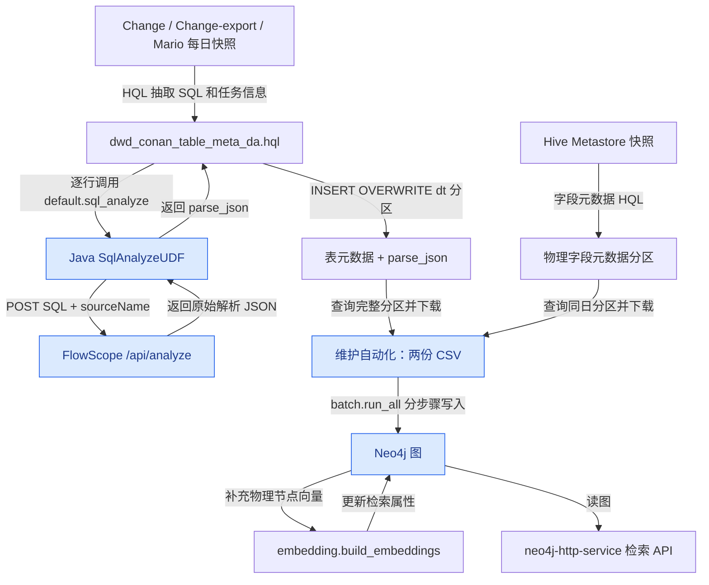

# 现行解析、入图和运行机制

调研日期：2026-11-25，时区 UTC+8。本轮只读业务系统；没有执行解析 POST、数据库写语句、维护自动化或生产刷新。

## 1. 证据范围

核对了 FlowScope、neo4j-http-service、bigdata-hive-udf、data-analysis-template 的本地源码，以及生产 FlowScope 健康/配置、Neo4j 元数据、正式 HTTP OpenAPI、本机维护自动化及其运行记录。线上 Hive 注册函数对应的 JAR、线上 Change 正式脚本/调度配置未回读；因此下述 UDF 和 HQL 行为是当前本地实现证据，不能替代已部署版本核对。

本会话的 trellis-start skill 未在项目或已安装 skill 目录找到；启动上下文改由已有 `.trellis/workflow.md`、`.claude/commands/trellis/continue.md`、`get_context.py --mode phase --platform codex-inline` 加载。按用户同意创建规划任务，未执行 task.py start。

## 2. 当前源码链路

这是源码与配置定义的链路，图中箭头不表示最近一次运行已全部成功。维护自动化最近读到的运行在前置检查处停止。

### Hive UDF

文件：`/Users/blank/wangliang/gitcode/bigdata-hive-udf/src/main/java/com/yuanfudao/bigdata/udf/SqlAnalyzeUDF.java`。

- 第 31 行：指向 FlowScope 的 `/api/analyze`。
- 第 40、55 行：单次 evaluate / postAnalyze；不是批量写图客户端。
- 第 60 行：只传 taskName 作为 sourceName，没有 scheduler、稳定 task_id、发布版本或元数据快照。
- 默认展开 CTE 并启用列血缘，连接/读取超时为 5 秒/30 秒。
- 异常返回 null；非 2xx 有响应体时返回该响应体。后续存储必须校验结构和业务状态，不能只把非空字符串当作成功解析。
- `SELECT 1` 有直接返回字符串 `1` 的特殊路径，更说明 UDF 返回值不能无条件视为完整 AnalyzeResult。

### 每日源表

文件：`/Users/blank/wangliang/gitcode/data-analysis-template/warehouse/change/conan/dwd/dwd_conan_table_meta_da.hql`。

- 第 91 行附近：以 `${date}` 抽取启用的 Change project=5 快照，并关联线上文件/脚本信息。
- 第 243、303、404 行：对 Change、Mario 和导出补充分支调用 sql_analyze。
- 第 317 行：覆盖写入 `${date}` 分区。
- 第 336 行附近：用 file_content 的 MD5 作为 task_sql_md5；同时保存原 SQL 和 parse_json。
- 还有项目、状态、文件类型、导出目标补全等条件。当前范围不是全公司所有调度系统，更没有任意即席 SQL 执行日志的完整采集。

字段元数据：`warehouse/change/conan/dwd/dwd_conan_table_column_meta_data_analysis_da.hql` 从 Metastore 的库/表/字段快照补物理字段，不由 FlowScope JSON 直接生成可信字段类型与注释。该本地 HQL 还存在按 `current_date()-1` 选择上游表集合的逻辑，历史分区回放时须单独核对，不能因输出 dt 一致就假定源快照一致。

### FlowScope

- `crates/flowscope-cli/src/server/api.rs:186` 的 analyze 调用 core 并返回 AnalyzeResult，没有图或 PostgreSQL 写入。
- 当前 HTTP 请求的 sourceName 是自由展示标识，不是可信发布身份；HTTP 方言取服务配置，不能假定客户端传 dialect 即生效。
- `crates/flowscope-core/src/types/response.rs:118` 提供 targetTable/sourceTables/statements/nodes/edges/issues/summary，且有可选 SQL 指纹。
- `crates/flowscope-cli/src/server/audit.rs:150` 对结果 JSON 做 1 MiB 截断；第 300、353 行使用内存队列异步写 SQLite，失败只记日志。因此现有审计不能当作完整结果仓库或可靠投递队列。
- `.trellis/spec/flowscope-core/backend/analyze-result-contract.md` 明确多个物理目标会缺省 targetTable 并报 MULTIPLE_TARGET_TABLES；适配器不能静默取第一个目标。
- SQL 指纹用于模板归组，原始 SQL MD5、解析产物版本、源发布版本应分开。解析器构建、schema 和动态参数会影响解析结果，不能仅凭相同 SQL 去重所有更新。

### 入图与查询

- `neo4j-http-service/src/batch/run_all.py:51` 编排表、物理字段、READS_FROM、SYNC、JOIN、UNION、CTE、列血缘、窗口控制、残留清理及验证。
- `_neo4j_writer.py:60` 每条模板/每批独立 session.run 提交；整个来源更新没有跨步骤原子事务。
- `load_reads_from.py:55` 以端点和 filters_md5 合并 READS_FROM，sql_md5_list 去重累积。frequency 是不同 SQL MD5 数，不是实际执行次数。
- `load_col_lineage.py:915` 的旧版本清理默认关闭；有当前 target_map 的局部替换，但各批分开提交，不保证整份新解析的原子可见。
- `load_sync` 对已确认活动 SYNC 有替换入边逻辑；不能把所有 loader 一概称为只追加。
- `.trellis/spec/backend/lineage-version-scope.md`：CTE/Derived 允许被多个 scope 共享，scope 是 `change:<task_id>` 或 `mario:<mario_template_id>`。无可信 provenance 的 legacy 节点不按 task_id 猜测删除。
- `src/service/neo4j_client.py:62` 等位置按目标表 task_sql_md5 过滤部分旧 target_map 路径；这不是全图统一版本发布机制。
- `src/embedding/build_embeddings.py:247,289` 增量模式只补缺失向量。已有注释变更并不会自动重算向量，实时方案需增加按变更文本刷新。

## 3. 图结构与文档漂移

物理身份保留三/四段业务键：M_TABLE=(catalog, db_name, table_name)，Physical 再加 col_name。TEMPLATE=(scheduler,mario_template_id)，SYNC=(scheduler,task_id)。CTE 与 Derived 的 fs_uid 由 task_sql_md5 和解析节点 ID 组成，可跨任务共享。

现存关系方向：

| 关系 | 实际方向与职责 |
|---|---|
| READS_FROM | 上游表 → 下游表/模板/同步任务 |
| REF_TEP | 上游表/CTE → 下游 CTE |
| REF_TABLE_COL | 字段 → 所属表/CTE/输出容器；与 core ownership 的 relation→column 方向不同 |
| DERIVES_COL | 源字段 → 派生字段 → 目标物理字段；保留 data_flow / derivation / target_map 等子语义 |
| JOINS_WITH | 主表 → 关联表，按既有规则处理 RIGHT JOIN 和条件 |

本地新增 CONTROLS_COL 用于窗口控制依赖；不得把它变成值来源。LINEAGE_SCOPE / OWNS_LINEAGE 用于归属。它们当前未出现在生产图库中。

`docs/plan/graph-schema.md:1334` 描述了 `/api/v1/graph/sink` 及异步入口，但其中引用的 infra/graph/graph_writer.py 不在当前实现中。当前注册路由与正式环境 OpenAPI 均没有这些路径；该节属于历史设计资料，不能据此认定接口已部署。

## 4. 运行核查

结构化只读结果见 `runtime-evidence.json`。

| 对象 | 已观察结果 | 能证明的范围 |
|---|---|---|
| FlowScope /api/health | ok，0.7.0 | 服务可达和版本字符串；不是当前本地提交已部署的证明 |
| FlowScope /api/config | Hive；has_schema=false；SQLite 审计启用 | 当前生产配置未加载外部表结构 |
| 正式 Neo4j HTTP health | connected=true；embedding_model_loaded=true | 服务及图连接健康，不等于图数据新鲜 |
| 正式 OpenAPI | 只有查询类血缘路由，另有 text2sql 审计写入 | 没有通用血缘写入接口；不能将审计接口当入图接口 |
| Neo4j | 5.27.0 Community，六个现存业务唯一约束 | 首期不能依赖 Enterprise 多数据库隔离；开发验证使用独立实例 |
| 物理表/字段 | 4,324 / 70,766 | 只读计数，不是与 Hive 总量的完整对账 |
| TEMPLATE / SYNC | 378 / 404 | 已有模板和导出任务，不是只包含普通 Change SQL |
| M_TABLE 最大 utime | 2026-10-27T11:30:44.658Z，即 UTC+8 19:30:44.658 | 表节点最后更新时间上界，不等于源分区或所有关系更新时间 |
| LINEAGE_SCOPE | 0；无 scope 唯一约束，无 OWNS_LINEAGE 类型 | 本地新增归属结构尚不在本次连接的生产图库中 |

维护配置：`/Users/blank/.codex/automations/neo4j/automation.toml`，启用，工作日 10:00，按 Asia/Shanghai 昨日分区维护。计划规定完整分区与 CSV 校验、图备份、batch、环路检测、向量化、图和 HTTP 验收；图刷新与 DocZ 报告状态分开。

最近读到的 2026-11-24 记录：处理 2026-11-23 分区前，`uv run --locked` 返回锁文件需要更新；查询、CSV 下载、batch 和 embedding 均未开始。`/tmp/neo4j_daily_2026-11-23_preflight.log` 有对应错误。本轮未重新运行或修复维护任务。未找到本轮扫描位置下的 refresh-complete.json 成功凭证；不据此推断其他位置绝无成功记录。

## 5. 对规划的约束

后续技术选型已由用户明确为方案 B：在 FlowScope 内实现 Rust 存储层。本文保留 Python 现状证据；原项目只用于规则参考和既有结果对照，不表示新链路仍需运行它。移植边界见 `rust-porting-map.md`。

1. 存储层要从数据转换和版本归属层抽离；只抽 Bolt 连接包装不能达到目标。
2. 原 UDF 没有 token、稳定 ID 或源版本；匿名迁移模式只能解析/审计，不能替换正式图。升级可信身份和结构化上下文后，才可按调度策略发布。
3. 实时入口同时服务调度发布与运行观测时，必须区分“已发布定义”和“实际执行记录”。
4. 旧批量路径不能在实时切换后继续裸写同一来源，否则版本判断会被绕过。
5. 现有图可做对照，但现有生产图不是已经具备 scope 与当前版本语义的迁移基线。
6. 先在隔离实例验证新存储语义，存量回填和生产切换另行明确授权，不用本轮规划授权代替。

## 6. 官方事务依据

- [Neo4j 5 MERGE](https://neo4j.com/docs/cypher-manual/5/clauses/merge/)：并发下 MERGE 本身不等于唯一性保证；仍需要业务唯一约束和写入串行化。
- [Neo4j Python 事务](https://neo4j.com/docs/python-manual/current/transactions/)：原 Python 实现的事务参考资料；不能据此推断 Rust 驱动具有相同托管事务和自动重试行为。Rust 适配器需单独验证实际选定驱动的事务、提交未知与重试契约。
- [PostgreSQL 17 INSERT](https://www.postgresql.org/docs/17/sql-insert.html)：后续适配器可用唯一键和 ON CONFLICT 完成幂等入库；当前版本切换仍需要事务及版本比较，不能只靠 upsert。
