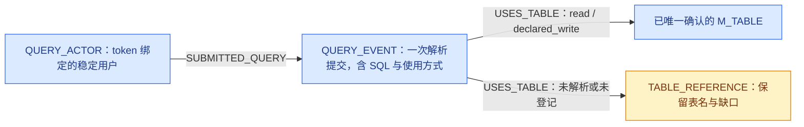

# 统一 analyze、策略页面与个人查询使用记录

2026-11-25 本轮功能与接口规划，尚未实现。继续采用 FlowScope 原生 Rust 存储层。用户确认解析成功与图更新成功分别表达，并新增策略页面、调度 token 自动更新、个人 token 查询标记的要求。

## 1. 本轮采用的行为

| 调用身份与管理员策略 | 请求入口 | 默认行为 |
|---|---|---|
| 调度 token，publish 已启用且范围允许 | `/api/analyze` | 解析和版本检查通过后自动排队更新正式血缘 |
| 个人 token，record_usage 已启用 | `/api/analyze` | 记录这个人的解析提交及表使用方式，不修改正式血缘 |
| 已认证主体配置 observe | `/api/analyze` | 独立保存完整解析历史，不建立个人使用关系或正式来源贡献 |
| 已认证主体配置 parse_only | `/api/analyze` | 解析及 SQLite 审计，不向 Neo4j 写入 |
| 匿名旧请求，仅在明确迁移窗口开放 | `/api/analyze` | 只解析/SQLite 审计，不猜个人身份，不写 Neo4j |

生产严格模式统一要求 Authorization Bearer。只有身份可确定，才能按 token 策略区分调度系统、用户和管理员。缺失/无效 token 返回 401，已认证但越权返回 403。这里控制的是解析结果落图能力，不替代数仓引擎的真实数据访问权限。

管理员在服务端把稳定 principal_id 绑定到调度服务或个人账号。token_id 为凭据身份，轮换 token 不拆分用户；sourceName、请求自报用户/类型/IP 都不能替代该映射。账号来源在实施前核实，可先可信人工登记，不为此新建完整单点登录系统。

## 2. 当前 SQLite 事实

源码 audit_log 已有 ts、sql_text、sql_hash、source_name、file_name、target_table、success、result_json、result_truncated 等字段。success 来自 `!result.summary.has_errors`，成功可以包含 warning；analyze 写入 error_msg=None，真正解析问题要看 result_json.issues。现有结果可能超过 1 MiB 截断，writer 是异步且失败只记日志。

所以策略页可以复用现有记录作为查询与模拟依据，但不能据此自动恢复可信主体或当作完整可靠写入事件。若用户指的是某条 success=true 却含 error 级问题，需要具体审计行进一步核对；本轮未读取实际 SQLite 记录，不把笔误或源码事实当作已证实 bug。

拟扩展 audit_log 的 request_id、event_id、principal_id、token_id、policy_revision 及独立存储状态关联；一个 files[] 请求可有多个审计行，但个人使用事件按同一 event_id 只记一次。

## 3. 统一 API 合同

保持 `/api/analyze`，取消前稿另设解析发布入口的安排。首期使用 `Authorization: Bearer <调用方凭据>`；下述 body 为拟新增上下文，当前接口尚不识别这些语义。

调度示例：管理员已经给该调度主体启用 publish，调用方不需要每次额外传 publish 标志。

```json
{
  "sql": "INSERT OVERWRITE TABLE dw.target SELECT id FROM dw.source",
  "sourceName": "daily_target.hql",
  "lineage": {
    "sourceSystem": "change",
    "sourceId": "123",
    "sourceVersion": "42",
    "eventKind": "publish",
    "environment": "prod"
  }
}
```

sourceVersion 的可比较顺序由来源适配器约定，不按任意字符串字典序决定。任务名称不能代替稳定任务 ID，旧 UDF 需要升级 token 和结构化上下文，不能只增加一个自由 token 请求字段。

个人示例：用户身份由个人 token 识别，body 不填用户名来授权。

```json
{
  "sql": "SELECT o.user_id, SUM(o.amount) AS amount FROM dw.orders o JOIN dw.users u ON o.user_id = u.user_id WHERE o.dt = '2026-11-25' GROUP BY o.user_id",
  "sourceName": "个人订单分析"
}
```

请求可以选择比默认策略更低的 preview/observe/parse_only 行为；个人不能通过 mode=publish、sourceSystem=change 或 INSERT SQL 改写正式血缘。环境与任务范围由服务端核对。调度有 token 但缺版本或解析不完整时保存未激活原因，不能清空旧正式关系。

现有 AnalyzeResult JSON 结构保持兼容。拟增加响应头 X-FlowScope-Request-Id、X-FlowScope-Event-Id、X-FlowScope-Action、X-FlowScope-Storage-Status；浏览器需能读取这些头并允许 Authorization 预检。查询状态使用 `/api/lineage/events/{event_id}`，返回 parse_status、lineage_status、usage_status、有效策略版本与原因。queued 只表示本地持久化，lineage/usage committed 分别表示各自 Neo4j 事务成功。

## 4. 个人图标记的含义

图的目标是回答“谁提交过哪些表的 SQL、使用了哪些条件/关联/字段”，首先是解析提交证据。现有 `/api/analyze` 没有执行 SQL 或接收执行结果的能力；不得将此记录命名为数据库实际访问成功，执行状态默认 not_observed。



QUERY_ACTOR 用 principal_id 唯一。QUERY_EVENT 用 event_id 唯一，关联审计与完整解析产物，保存提交时间、SQL 类型、WHERE/HAVING、JOIN 条件、聚合、窗口、已解析字段及完整性。完整 SQL 仍可回看，图属性只放可验证的摘要或产物引用。

USES_TABLE 表示用户 SQL 中使用该表，方向是事件→表。不能复用正式的 READS_FROM、DERIVES_COL、REF_TEP 或归属边表达个人关系，避免污染现有生产上下游遍历。未知或歧义表不凭个人 SQL 新建 M_TABLE/Physical，改用独立 TABLE_REFERENCE，待可信元数据补齐后再绑定。

具体例子：个人提交 `INSERT OVERWRITE TABLE dw.target SELECT id FROM dw.source` 时，可记录 read→source、declared_write→target，但不生成 source→target 的正式 READS_FROM，也不改变 target 的 task_sql_md5。个人的声明写入不等于实际写入成功。

解析失败保留个人事件、原 SQL 和 errors，不生成可信使用边。仅字段未决而表已唯一解析时，可记录表使用并标 partial/unresolved，不能虚造字段。重试同一 event_id 不重复计数；新的独立请求可以形成新事件。统计称“解析提交次数”，不能称“SQL 执行次数”。真实执行 ID/状态以后只能由受信执行平台补充，个人自报成功不构成证据。

## 5. 策略页面功能范围

本轮定义功能、权限与数据需求，不交付视觉稿、交互原型或 UI 代码。现有入口是 `/audit`，暂定新增 `/settings/lineage-policy`。页面实现沿用项目组件与状态约定，不在本轮生成 PRODUCT.md 或另建前端项目。

| 功能区域 | 用户要完成的动作与反馈 |
|---|---|
| 调用方与 token | 管理员登记调度/个人主体，发放/轮换/停用凭据；列表显示名称、类型、token_id、状态、最近调用，原始 token 只在发放时展示一次 |
| 默认动作 | 为调度选择 publish/observe/parse_only，为个人选择 record_usage/observe/parse_only；个人 publish 不开放且 API 同样禁止 |
| 范围与禁止规则 | 配置环境、来源系统/任务范围、需要的表范围和显式禁止；展示谁能改正式图、谁只能写使用记录 |
| 记录判定预览 | 从审计选样本或输入上下文，显示身份、命中规则、拟采取动作与不允许原因；模拟不写 Neo4j、不授予权限 |
| 保存与生效 | 显示已保存 revision 与 active_revision；成功激活才显示已生效，失败可重试并保留原规则；旧页面并发保存冲突需重新加载 |
| 审计回溯 | 在现有审计列表/详情分别展示解析状态、正式血缘状态、个人使用状态、调用方、策略版本与失败原因，能跳到对应策略 |

页面需要覆盖无主体、无规则、凭据停用、模拟不匹配、保存冲突、持久化成功但未激活、无管理权限、后端/存储不可用等状态。普通个人只能看自己的记录，调度只能看授权来源，策略管理需要 policy_admin；后台 API 必须执行同样限制，不能只隐藏按钮。

选择一条历史匿名审计不能一键把它变成正式发布；无法确认身份/版本时只可回看或模拟。修改策略不自动重放历史。若后续提供显式重放，必须使用当前可信主体、原 SQL、重新解析与源版本检查，并单独记录操作。

## 6. Rust API 与 SQLite 生效链路

拟定管理能力包含主体/token 查询与生命周期、策略读取/保存、无副作用的策略预览；路径在实施前冻结。它们属于 FlowScope Rust API，受 policy_admin 授权，个人查询自身事件另行按主体限定。管理员初始凭据由受控部署配置提供，不从普通匿名解析请求创建。

SQLite 保存主体表、token 摘要表、策略及变更记录、完整 lineage_event 与 audit_log 的关联。新采集路径原子持久化事件与关联，不能同时走旧 audit channel 再插入重复记录；老匿名 parse_only 可维持原审计方式。完整事件不受 audit.result_json 的 1 MiB 截断规则影响。

保存顺序为管理 API 校验→检查 expected_revision→SQLite 事务保存新 revision→更新运行时策略快照→返回 active_revision。运行时未切换时不得宣称已生效，待生效状态的处理行为要明确且不能凭旧授权新发放权限。服务重启从持久策略恢复，后台逐事件复核当前主体与策略。

撤权约束作用于未开始的新提交和队列事件；已开始的事务记录当时的 policy_revision，页面需能说明在途状态，不承诺自动回滚已经提交的图。生效边界和并发提交的处理必须用受控用例验证，不用“配置保存成功”代替权限已生效。

策略变更、解析结果与两个 Neo4j 结果独立记录：解析成功但图失败、正式图成功但个人使用未请求、usage 成功而正式图未请求，均应可解释。

## 7. 验收场景

1. 两个 token 调同一 `/api/analyze`：调度按 publish 更新正式图，个人按 record_usage 只写个人标记。
2. 个人伪造 sourceName、用户 ID、sourceSystem 或 publish mode 均不能改正式图；token 轮换仍归同一用户。
3. 个人 INSERT 只记录 declared_write，已有 M_TABLE/task_sql_md5/READS_FROM/DERIVES_COL 不变；未知表不新增正式元数据。
4. WHERE/JOIN/字段/聚合/窗口信息可回看，未决状态不被标为完整；解析错误仍有记录但不产生可信使用边。
5. SQLite queued 与 Neo4j 两种 committed 状态分别验证；重试不重复增加用户事件或计数，多文件请求不多算次数。
6. 管理页面保存后，下一次请求/未开始队列事件使用新 active_revision；重启后仍生效，保存冲突与未激活状态可见。
7. 普通 token 访问管理接口或他人 SQL 详情被拒绝；策略预览不写图，改策略不自动发布旧匿名记录。
8. 新客户端带 Authorization 和可读取状态响应头；迁移匿名模式仅 parse_only，严格模式缺失/无效 token 为 401。
9. 在无 Python 服务的环境完成上述流程；真实执行尚未接入时，个人页面和图均不声称已查询成功。

## 8. 界面实现前的设计上下文

已核对现有 AuditPage、App 路由与 UI 协议。impeccable 的 loader 返回项目没有 PRODUCT.md/DESIGN.md。本轮只写功能、API 和数据规划，不进入视觉布局、原型或 craft，不把缺失的产品语境伪造为已确认。正式页面设计时需按现有 skill 补齐必要上下文；这不阻止本轮完成接口、策略和使用记录的规划。
