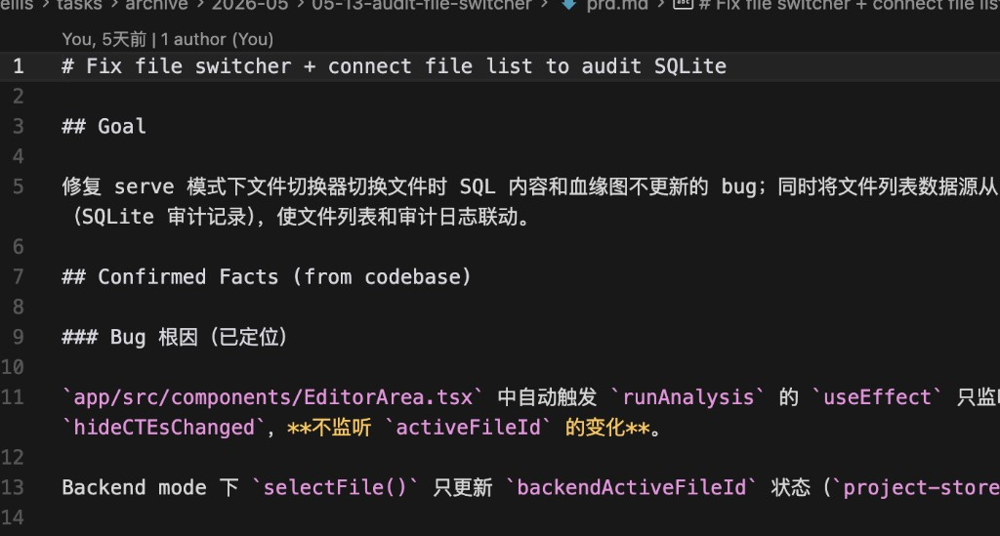

# 验证 Trellis task PRD 图片支持

## Goal

测试 Trellis task 的 PRD 文档是否支持嵌入截图，验证 Cursor IDE 能否正确渲染 markdown 中的本地图片引用。

## 背景 / 问题描述

在记录 bug 或 task 时，有时需要附上截图辅助说明问题现象。
例如：某 task 对话界面正在编写 PRD，当前焦点在 `05-13-audit-file-switcher/prd.md`。

**问题截图**（用户在 Cursor 对话框中上传的截图）：

上图展示了：
- Cursor IDE 中打开的 `.trellis/tasks/archive/2026-05/05-13-audit-file-switcher/prd.md` 文件
- PRD 文件头部内容（Fix file switcher + connect file list to audit SQLite）
- git blame 信息显示 "You, 5天前 | 1 author (You)"

## 验证方式

| 方式 | 语法 | 说明 |
|------|------|------|
| 相对路径本地图片 | `` | 图片与 prd.md 同目录 |
| 绝对路径本地图片 | `` | 从项目根开始 |
| 外部 URL 图片 | `` | 网络图片 |

## 结论

- [ ] ~~Cursor IDE 的 markdown 预览支持相对路径本地图片渲染~~ ❌ **实测不渲染**
- [ ] 相对路径本地图片在 Cursor Markdown Preview 中只显示 alt 文字，图片不显示
- [x] 外部 URL 图片（`https://...`）可正常渲染

**验证时间**：2026-05-18  
**实测结果**：`` 在 Cursor Preview 中只显示 "alt 文字"，无图片渲染。

## 最佳实践（修订）

记录 bug task 时，若需要图片可视化：

1. **推荐：上传到 GitHub Issue**，获取托管 URL 后在 PRD 中引用 ``
2. **次选：上传到图床**，用外部 URL 引用
3. **不推荐**：本地相对路径引用（Cursor Preview 不渲染）
4. 截图文件仍可保存到 task 目录作为附件，但 Markdown 引用需用 URL 形式

## Out of Scope

- 不测试 git 是否自动追踪图片文件（二进制文件需手动 `git add`）
- 不验证图片压缩或格式转换
