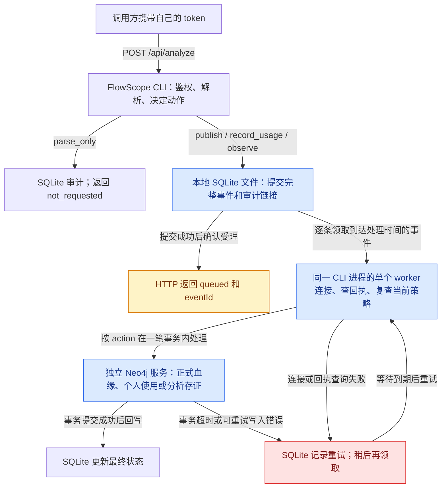
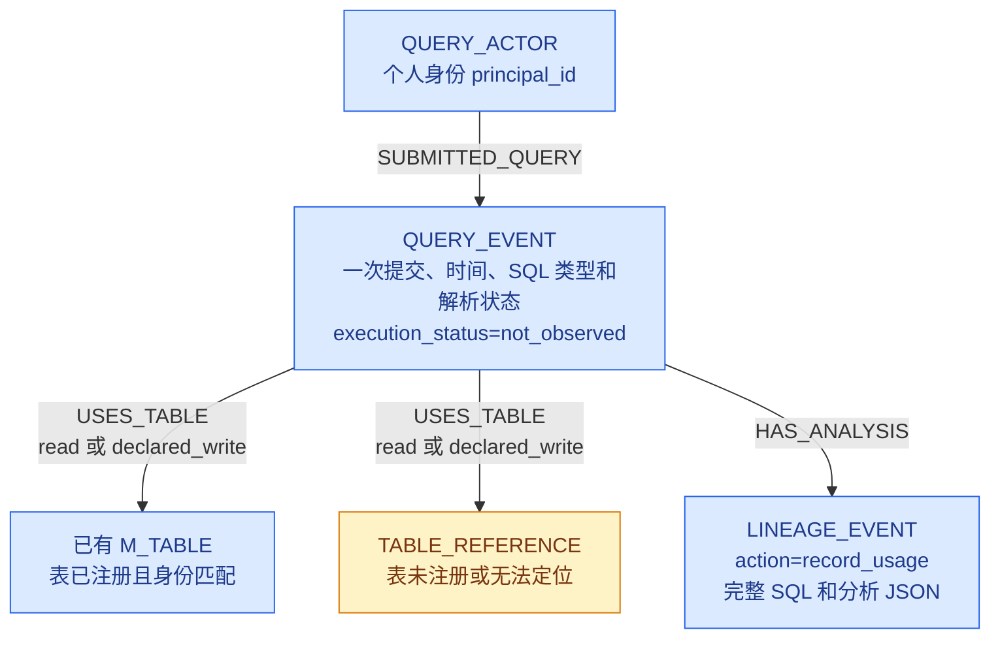

# FlowScope 入图原理 提速方式与个人查询记录

正式血缘由调度系统按任务版本发布，个人提交的 SQL 则记录为独立查询事件。图中已有的物理表和字段按身份键复用；新增或变更的血缘先保存来源证据，再生成当前可用关系。个人使用次数通过查询事件聚合，不能用正式血缘关系上的 frequency 代替。

本文说明当前源码行为、已有图与新增内容的处理规则，以及“昨天谁提交了引用哪些表的 SQL”如何查询。本文对应本任务的 Rust 批量写入候选，基线为 f994d2f6。2026-11-27 已在线上补齐查询索引并恢复 651353；批量代码已在隔离环境验证并打包上传 Linux CLI，尚未部署到生产服务。个人统计示例已在隔离图执行，也在线上做了只读核对。

## 651353 为什么一直重试，怎样恢复的

2026-11-26 的初次快照显示重试 104 次，2026-11-27 09:41 已达 639 次。解析成功，SQL 为 4,771 字节，分析结果有 330 个节点、493 条边；这不代表 Neo4j 已提交。

取证确认线上有 94,555 条 LINEAGE_FACT，但只有 fact_key 的唯一索引，没有 edge_key 查询索引。刷新一条关系时，旧实现都执行一次按 edge_key 过滤并排序的查询。PROFILE 显示 NodeByLabelScan 读取全部 94,555 条事实，仅扫描和过滤就有 189,111 次数据库属性/节点访问。存储规范化后，本样本需要 494 个实体、657 条事实，因此会重复扫描和多次往返。

worker 对一笔 apply 设置 30 秒限制。旧版隔离实测的版本更新为 32.58–38.19 秒；这种情况会超时、回滚、保留 queued 并退避重试。旧错误记录把这些超时和连接/回执问题统一写成 neo4j_temporarily_unavailable，页面无法据此判断具体阶段。

2026-11-27 09:49 在线上补齐三个索引后，651353 由现有 worker 自动提交，累计重试停在 644 次，Neo4j 回执 committed_at 为 09:49:43.889（Asia/Taipei）。09:50 的事件接口和审计详情均为 committed。没有手工改状态、重交 SQL 或删除业务图。该干预与隔离复现共同支持上述根因；历史每一次重试的原始异常没有保存，不能逐次还原。

已补齐的索引：

| 名称 | 标签和属性 | 用途 |
| --- | --- | --- |
| flowscope_fact_edge | LINEAGE_FACT(edge_key) | 刷新受影响关系时查历史事实 |
| flowscope_fact_scope_active | LINEAGE_FACT(scope_key, active) | 找到并停用当前来源的有效事实 |
| flowscope_scope_target | LINEAGE_SCOPE(target_key, withdrawn) | 汇总目标表的有效生产来源 |

索引修复后，相同查询计划使用 NodeIndexSeek。前后并非同一份事务快照：修复前所查边尚未提交、返回 0 行，修复后已提交、返回 1 行，因此单次 wall time 不作为严格性能对比；稳定的证据是从全量扫描变成索引定位。

审计表的 ms 在入队前计算，主要反映分析阶段，不包含排队及 Neo4j 写入耗时。之前的 437 条 queued、1,287 条 committed 等数字属于 11 月 26 日的审计行快照，不代表本次恢复后的队列状态，也不是图节点或去重事件数。

## 入口与后台写入如何衔接

入口是 POST /api/analyze。token 先找到调用方，再按调用方启用状态和默认动作处理。请求不能自行把个人身份升级为正式发布身份。

| 动作 | SQLite | Neo4j | 常见用途 |
| --- | --- | --- | --- |
| parse_only | 审计记录 | 不创建存储事件 | 只分析 SQL |
| observe | 完整事件和审计链接 | LINEAGE_EVENT 分析存证，不生成正式血缘或个人使用关系 | 观察和诊断 |
| publish | 完整事件和审计链接 | 版本化正式血缘及存证 | 调度任务发布 |
| record_usage | 完整事件和审计链接 | 查询人、查询事件、引用表及存证 | 个人 SQL 使用记录 |

下面的图用于判断：HTTP 确认了什么，后台在什么位置真正提交 Neo4j。API、解析器和 worker 都在同一个 FlowScope CLI 进程里；SQLite 是本地文件，Neo4j 是独立数据库服务。



queued 表示完整事件已存入 SQLite，尚不能确认图事务成功。worker 和 HTTP 返回可以交错执行，不能根据前端已返回推断 Neo4j 已完成。GET /api/lineage/events/{eventId} 可读取解析、正式血缘、个人使用状态及重试次数。

worker 每次领取一条到达重试时间的 queued 事件，按 created_at、id 排序。它先检查 Neo4j 是否已有该事件的提交回执，再检查最新策略，最后尝试写入。这使“Neo4j 已提交，但 SQLite 还没更新”的恢复不会重复发布。

复查发现调用方停用、token 撤销或动作已被策略禁止时，事件变为 blocked_policy，不开始新的图事务。已经提交的 Neo4j 回执仍按已提交结果恢复。

候选版本为连接及建索引准备阶段预留 120 秒，每个索引等待 ONLINE 最多 60 秒；回执查询仍为 8 秒，写入仍为 30 秒。线上旧二进制尚未替换，其连接阶段仍为 8 秒。重试逐步退避到约 60 秒一次，事件继续保持 queued。observe 也走这个存储 worker，不能把它理解为只写 SQLite。

源码：[入口及 worker](../../crates/flowscope-cli/src/server/lineage.rs)、[SQLite 入队和领取](../../crates/flowscope-cli/src/server/lineage_policy.rs)、[单个 worker 的启动](../../crates/flowscope-cli/src/server/mod.rs)。

## 正式血缘如何处理已有图和新增内容

以这个任务为例：

```sql
INSERT OVERWRITE TABLE dw.summary
SELECT user_id, SUM(amount) AS amount
FROM dw.orders
GROUP BY user_id;
```

发布请求还需要 sourceSystem、sourceId、sourceVersion、environment 等任务信息。系统用“环境＋来源系统＋任务 ID”标识一个来源范围，用 sourceVersion 和 analysisRevision 共同判断新旧版本。

### 节点用什么判断是否已经存在

MERGE 按指定的身份键匹配，找到则复用，找不到才创建。相同显示名称不一定是同一节点。

| 对象 | 匹配键 | 处理方式 |
| --- | --- | --- |
| M_TABLE 物理表 | catalog、db_name、table_name | 复用已有表，补充 LINEAGE_ENTITY 标签、lineage_key 和更新时间等管理属性 |
| M_COL:Physical 物理字段 | catalog、db_name、table_name、col_name | 复用字段，补充已核实的字段属性和管理信息 |
| CTE | fs_uid | 与当前分析产物关联的中间表节点 |
| M_COL:Derived 派生字段 | fs_uid | 表示本次分析中的表达式或中间结果字段 |
| TEMPLATE | scheduler=mario、mario_template_id | 复用对应 Mario 模板身份 |
| SYNC | scheduler=change、task_id | 用于 sourceSystem=change-export 的同步输出 |

catalog 缺省规范化为 hive。已有节点如果 catalog 缺失、库名不同或表名大小写不一致，可能无法按同一身份键匹配，需要先统一元数据身份。不能只看图上显示的表名相同就判断复用了同一节点。

### 各种已有和缺失场景

| 场景 | 当前处理 |
| --- | --- |
| 表和字段都已存在，新增血缘关系 | 复用物理节点，新增当前来源版本的事实，再生成相应关系 |
| 图中没有表，但本次解析有可信 Schema | 创建本次分析涉及的 M_TABLE 和所需物理字段，再写关系；不是自动导入整张表的所有字段 |
| 图中没有某字段，可信 Schema 中有该字段 | 为涉及的字段创建物理字段节点，并建立本次血缘 |
| 图中已有表，但解析输入缺少可信元数据 | 仍可能 blocked；当前没有自动从 Neo4j 反查并补齐分析 Schema 的步骤 |
| 字段仅来自别名、星号未展开或 INSERT 目标字段未映射 | 阻止正式激活，避免猜造物理字段 |
| 已有当前管理的同一个 edge_key，另一任务也贡献该关系 | 合并有效来源集合，保持共享关系 |
| 已有旧系统的同名关系，但没有本系统的 projection_key | 旧关系保留；本系统可能另建带 projection_key 的关系，不能视为自动接管旧边 |
| 两端节点相同，但过滤条件、表达式或关系属性不同 | 可能具有不同 edge_key，形成多条有不同来源证据的关系 |
| 同一任务发布有效新版本 | 旧版本事实失效，新版本事实生效，并重算受影响关系 |
| 另一任务还贡献旧关系 | 保留另一任务的贡献，不因本任务换 SQL 而删掉共享关系 |
| 新版本有解析错误或元数据不足 | 记录阻止原因，保留之前有效的正式血缘 |
| 更旧版本迟到 | 返回 stale_source_version，不回滚当前有效版本 |
| 相同版本和相同分析产物再提交 | 返回 already_current，不重复重建当前血缘 |
| 相同版本对应不同分析产物 | 版本冲突，图事务回滚；异步事件最终失败 |

可信 Schema 来自本次解析使用的 resolved_schema，其来源可能是请求 schema、服务端默认元数据或受支持的语句内声明。图中已有物理节点不会自动代替这项检查。

“blocked 不替换正式血缘”不表示完全没有写 Neo4j：分析存证和来源管理节点仍可能被保存。真正的数据库异常或版本冲突则会回滚该次图事务。

源码：[实体身份及 MERGE](../../crates/flowscope-storage/src/neo4j.rs)、[元数据检查](../../crates/flowscope-storage/src/normalize.rs)、[发布版本判断](../../crates/flowscope-storage/src/neo4j.rs)。

### 为什么要保存事实再生成关系

系统同时维护两层内容：

- LINEAGE_SCOPE、LINEAGE_REVISION、LINEAGE_FACT 保存哪个任务、哪个版本贡献了什么血缘。事实用 active 标记当前是否有效。
- READS_FROM、DERIVES_COL、REF_TABLE_COL 等关系表达当前仍然有效的结果，带 projection_key、source_scopes 和 sql_md5_list 等属性。

新版本不是只补新增边。当前实现会把这个来源的旧事实统一设为失效，写入新版本事实，再重新生成旧、新事实涉及的关系。它不会清空整张图，也不会删除其他来源仍有效的贡献。旧事实和历史节点会继续留存。

例如，任务 A 和任务 B 都贡献 orders → summary。后来 A 改为 payments → summary，orders → summary 仍由 B 支撑而保留；B 再撤回自己的贡献后，本系统管理的旧关系才删除。其物理表节点和历史证据不会一起删除。

关系上的 frequency 是有效事实中不同 SQL MD5 的数量。两个任务贡献相同 SQL 时，source_scopes 可以有两个，frequency 仍可能是 1。它不是提交次数，也不是个人使用次数。

注意，当前存储中的 READS_FROM 实际方向是输入表 → 目标表或逻辑输出；REF_TABLE_COL 是字段 → 所属表。不要只凭英文关系名猜箭头方向。

源码：[事实失效及重建](../../crates/flowscope-storage/src/neo4j.rs)、[关系投影与 frequency](../../crates/flowscope-storage/src/neo4j.rs)、[关系生成方向](../../crates/flowscope-storage/src/normalize.rs)。

## 个人查询如何记录

个人调用方需要 kind=person、默认 action=record_usage。每个人使用独立 principal_id，token 绑定到该身份；token 换新后，身份仍可保持不变。

当前不是在正式血缘边上简单增加 type=personal，而是建立独立查询事件：



这张图用于判断身份、单次提交、引用表和完整分析分别保存在哪里。读表和声明写表都先尝试匹配已有 M_TABLE，找不到则关联 TABLE_REFERENCE。

| 字段或对象 | 回答的问题 |
| --- | --- |
| QUERY_ACTOR.principal_id | 谁提交 |
| QUERY_ACTOR.principal_type=person | 这是个人身份 |
| LINEAGE_EVENT.action=record_usage | 这次请求采用哪种存储动作 |
| QUERY_EVENT.sql_type | SQL 是 select、insert 还是其他类型 |
| QUERY_EVENT.observed_at | 何时收到这次提交 |
| USES_TABLE.usage_role=read | SQL 引用了哪个输入表 |
| USES_TABLE.usage_role=declared_write | SQL 声明写哪个表，不证明执行成功 |
| QUERY_EVENT.parse_success | 是否解析成功 |
| QUERY_EVENT.execution_status=not_observed | 没有观测数据库实际执行结果 |

个人请求只关联已存在的 M_TABLE，找不到则创建 TABLE_REFERENCE，不会由个人 SQL 创建正式 M_TABLE、Physical 字段或替换正式血缘。即使个人 SQL 是 INSERT，也只记录声明的读写意图。显式要求 publish 会被拒绝。

解析失败也可以保存 QUERY_EVENT 和分析记录，但不会建立可信的 USES_TABLE。未来表注册为 M_TABLE 后，旧 TABLE_REFERENCE 的使用关系不会自动改接到正式表，所以统计时需要包含两类节点。

个人记录不要求完成正式发布所需的全部元数据校验：成功解析后，能定位已有表就关联，否则保留未知表引用。它不会因此补建正式物理元数据。

QUERY_ACTOR 当前保存身份 ID 和类型，没有同步显示名称字段；姓名映射需要结合调用方配置。多人共用一个 principal_id 时，只能统计该共享身份，无法还原具体的人。

源码：[个人查询入图](../../crates/flowscope-storage/src/neo4j.rs)、[读写引用角色](../../crates/flowscope-storage/src/normalize.rs)、[调用方动作约束](../../crates/flowscope-cli/src/server/lineage_policy.rs)。

### 有没有次数计数

当前没有维护每张表的个人 use_count 累加属性。系统保留单次查询事件，可以在查询时按人、表和日期聚合：

- 一次新的请求没有 Idempotency-Key，就产生一个新 event_id；重复提交同一条 SQL 也可以计为多次提交。
- 使用同一调用方下相同 Idempotency-Key 重试，内容相同会复用事件，不重复计数；内容不同在受理时返回 409。
- 后台重新尝试同一个事件，不增加个人提交次数。
- 一次提交多次引用同一张表，应使用 count(DISTINCT q.event_id) 避免把引用次数当作提交次数。
- 一个分析请求可以包含多条 SQL 或多个文件，一个 QUERY_EVENT 表示一次提交；这里统计的提交次数不是 SQL 语句条数或文件数。
- 不同 SQL 模板数、提交次数、实际执行次数是不同指标，不能混用。

正式版本冲突发生在后台图事务阶段，通常先返回 queued，再通过事件状态看到 failed；它与 Idempotency-Key 在 HTTP 受理阶段返回的 409 不同。

## 如何查昨天谁引用了哪些表

数据模型支持这个查询，但当前产品没有专门的按人按天聚合 API 或统计页面。现有入口主要是审计列表和事件详情；可以先用只读 Cypher 聚合图中的记录。

“昨天谁用了哪些表”在当前模型中准确指“昨天谁提交了成功解析且引用这些表的 SQL”。要判断数据库是否真正执行、是否成功、扫描多少行，需要对接查询引擎日志，关联引擎 query_id、执行人和执行结果。

以 2026-11-27 为当前日期、Asia/Taipei 为统计时区，昨天是 2026-11-26。区间采用左闭右开：

- from：2026-11-26T00:00:00+08:00，即 UTC 2026-11-25T16:00:00Z。
- to：2026-11-27T00:00:00+08:00，即 UTC 2026-11-26T16:00:00Z。

给下面查询传入字符串参数 from 和 to。它同时包含正式表和未注册表引用，按人、表及注册状态输出提交次数：

```cypher
MATCH (a:QUERY_ACTOR)-[:SUBMITTED_QUERY]->(q:QUERY_EVENT)
MATCH (q)-[u:USES_TABLE]->(t)
WHERE a.principal_type = 'person'
  AND q.parse_success = true
  AND u.usage_role = 'read'
  AND (t:M_TABLE OR t:TABLE_REFERENCE)
  AND datetime(q.observed_at) >= datetime($from)
  AND datetime(q.observed_at) < datetime($to)
WITH a, q, t,
     CASE WHEN t:M_TABLE
          THEN t.catalog + '.' + t.db_name + '.' + t.table_name
          ELSE t.qualified_name END AS table_name,
     CASE WHEN t:M_TABLE
          THEN 'registered'
          ELSE t.resolution_status END AS table_status
RETURN a.principal_id AS person_id,
       table_name,
       table_status,
       count(DISTINCT q.event_id) AS submitted_query_count,
       min(datetime(q.observed_at)) AS first_submitted_at,
       max(datetime(q.observed_at)) AS last_submitted_at
ORDER BY person_id, submitted_query_count DESC, table_name;
```

该查询已在任务隔离图执行：同一个 person-1 分别提交引用已注册 hive.dw.a 和未知表的 SQL，返回两组记录，各计 1 次。也在线上执行了只读统计：当前个人 QUERY_ACTOR 数量为 0，昨天统计为空；这只能说明当前没有对应个人事件，不能推出昨天无人查询数据。结果中的 person_id 需要映射调用方名称；未注册引用的名称可能尚未带完整 catalog，不能直接当作已经与正式表完成身份归一。

如需同时看声明写入，把 usage_role 条件放宽到 read、declared_write，并把 u.usage_role 加入分组和返回列。声明写入次数依旧不是实际写入成功次数。

之前的线上配置快照没有个人调用方，本轮图中也没有个人 QUERY_ACTOR。调用方删除后历史仍可保留，配置与图证据需要分别核对。已用共享 change 或管理员身份提交的记录，无法事后拆分到具体个人。要持续提供这个报表，需要让每个人以独立身份提交 SQL，并确保个人使用事件最终 committed；尚未成功入图的事件会使图中统计暂时不完整。

审计保留 7 天只清理 audit_log；当前并不自动删除 SQLite 持久事件或 Neo4j 的 QUERY_EVENT、LINEAGE_EVENT。个人历史保留期和图内数据清理需要另行制定。

## 本次怎样提速

1. 初始化自动建立并等待上述三个索引 ONLINE；生产已单独应用索引修复。
2. 实体按 kind 分组，以每批最多 256 条执行 UNWIND；表、物理字段、派生字段等身份键保持一致。
3. 受影响的关系锁仍按 edge_key 排序获取，分批后仍保持整个顺序。
4. 分批写 LINEAGE_FACT，并验证命中的两端节点数量；任一缺失都回滚整笔事务。
5. 一批读取受影响边的历史事实，按全部有效来源计算去重 SQL MD5、source_scopes 和 frequency，再按关系类型分批更新或删除本系统管理的投影。
6. 个人表引用分批匹配；已有 M_TABLE 则关联，没有则只创建 TABLE_REFERENCE。
7. 重试原因区分 connect、receipt、apply 和 policy_recheck，可重试的 Neo4j 错误保留安全错误码；不保存可能包含 SQL 或凭据的原始驱动消息。成功 apply 输出耗时日志，SQLite 状态保存失败会记录诊断，后续仍用回执恢复。

仍使用单个 worker。当前索引和批处理已能显著减少每个事件的处理成本；多 worker 需要增加 SQLite 原子领取/租约等机制，本轮没有在 next() 查询之上简单复制处理循环。

| 场景 | 旧版逐条、无事实查询索引 | 旧版逐条、仅补索引 | 候选批量版及索引 |
| --- | ---: | ---: | ---: |
| 首次入图中位数 | 20.072 秒 | 2.751 秒 | 0.235 秒 |
| 新版本替换中位数 | 32.747 秒 | 3.950 秒 | 0.305 秒 |

口径：同一台 Mac 的 debug 构建，任务独占 Neo4j 5.26 Community，94,555 条背景事实，651353 的同一完整 SQL/解析快照，测试来源固定为隔离身份，每组 3 轮。每轮先删除上轮业务图而保留相同背景事实，再首次写入并替换版本。计时从 LineageStore::apply 开始到提交返回，包含规范化，不包括连接初始化、SQLite 排队和 HTTP。样本少且环境与线上不同，不能把倍数直接当成生产吞吐承诺。

详细验证和 HTTP 队列结果见 [本次验证记录](../../.trellis/tasks/11-27-lineage-retry-throughput/verification.md)。审计解析 ms、端到端时间和 Neo4j 事务时间是三个指标，应分别观察。

## 源码阅读入口

| 问题 | 代码 |
| --- | --- |
| 请求如何选择存储动作和创建事件 | [lineage.rs](../../crates/flowscope-cli/src/server/lineage.rs) |
| 后台怎样领取、重试和保存最终状态 | [lineage_policy.rs](../../crates/flowscope-cli/src/server/lineage_policy.rs) |
| 物理身份、派生节点、事实和元数据验证 | [normalize.rs](../../crates/flowscope-storage/src/normalize.rs) |
| 个人查询的节点和关系 | [neo4j.rs usage](../../crates/flowscope-storage/src/neo4j.rs) |
| 已有版本、替换与撤回 | [neo4j.rs publish](../../crates/flowscope-storage/src/neo4j.rs) |
| 关系频次和共享来源的计算 | [neo4j.rs project](../../crates/flowscope-storage/src/neo4j.rs) |
| 版本、幂等和个人使用的既有测试 | [lineage.rs tests](../../crates/flowscope-storage/tests/lineage.rs) |

真实 Neo4j 测试默认忽略，只有显式提供任务独占的本地库时才运行。本轮已实际执行版本/个人/共享来源/回滚/并发、跨批次宽表、HTTP 策略重启和未知提交回执恢复测试；性能结果与正确性检查分开记录。线上已确认的是索引状态、651353 回执及 API 状态，批量二进制尚未部署。
